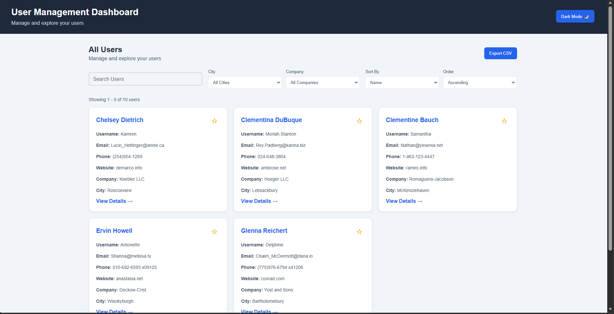
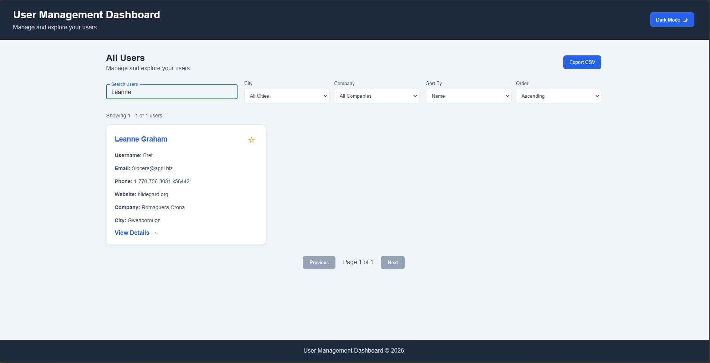
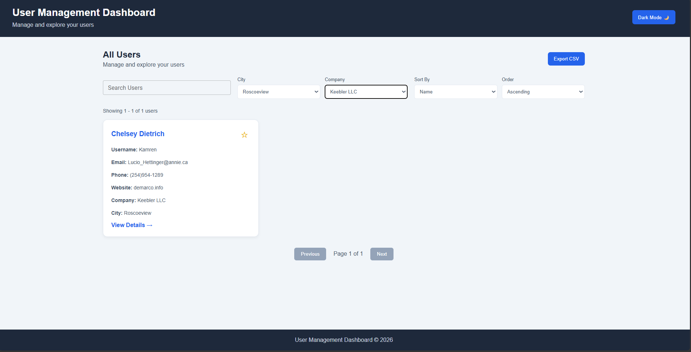
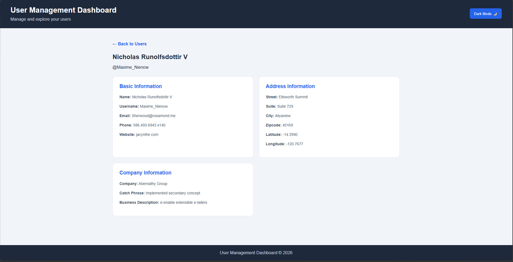
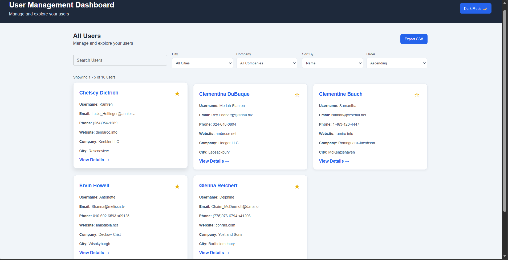
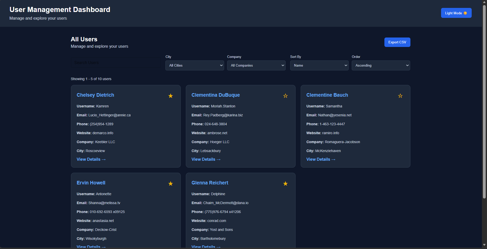
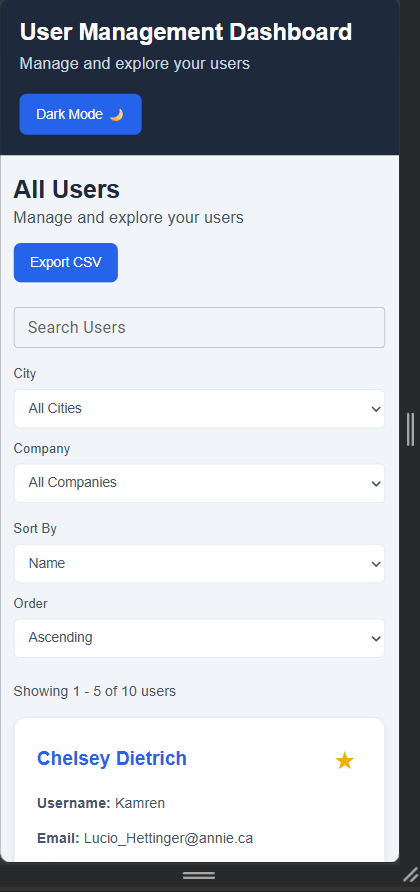

# User Management Dashboard

A responsive User Management Dashboard built using **React, TypeScript and Vite**. This project was developed as part of a Frontend Intern Assessment.

The application fetches user information from the JSONPlaceholder API and provides an interactive interface to search, sort, filter and manage users.

**GitHub Repository:** https://github.com/sourav021205/user-management-dashboard

## Features

- **User Listing:** Displays users in responsive cards.
- **Search:** Search users by name, username and email.
- **Debounced Search:** Uses a 400 ms debounce delay.
- **Sorting:** Sort by name, username and email in ascending or descending order.
- **Filtering:** Filter users by city and company.
- **User Details:** View complete user, address and company information.
- **Pagination:** Displays five users per page.
- **Favorites:** Add or remove favorite users with localStorage persistence.
- **Dark Mode:** Switch between light and dark themes.
- **CSV Export:** Export filtered users as a CSV file.
- **Loading and Error Handling:** Displays loading indicators, error messages and retry options.
- **Responsive Design:** Supports desktop, tablet and mobile screens.

## Technologies Used

- React.js
- TypeScript
- Vite
- React Router
- Fetch API
- Material UI
- CSS
- Jest
- React Testing Library
- ESLint
- Prettier

## API Used

JSONPlaceholder Users API:

https://jsonplaceholder.typicode.com/users

The application retrieves user information from this API.

## Project Structure

```text
src/
├── api/
│   └── usersApi.ts
├── components/
│   ├── Header.tsx
│   ├── Footer.tsx
│   ├── UserCard.tsx
│   ├── SearchBar.tsx
│   ├── FilterBar.tsx
│   ├── SortControls.tsx
│   ├── Pagination.tsx
│   ├── LoadingState.tsx
│   └── ErrorState.tsx
├── pages/
│   ├── UserListPage.tsx
│   └── UserDetailPage.tsx
├── hooks/
│   └── useDebounce.ts
├── services/
│   └── favoritesService.ts
├── types/
│   └── user.ts
├── utils/
│   ├── filterUsers.ts
│   ├── sortUsers.ts
│   ├── paginateUsers.ts
│   └── exportCsv.ts
├── routes/
│   └── AppRoutes.tsx
└── tests/
```

## Installation and Setup

### 1. Clone the repository

```bash
git clone https://github.com/sourav021205/user-management-dashboard.git
```

### 2. Navigate to the project directory

```bash
cd user-management-dashboard
```

### 3. Install dependencies

```bash
npm install
```

### 4. Start the development server

```bash
npm run dev
```

Open the local URL displayed in your terminal.

## Testing

Run all unit tests:

```bash
npm test
```

Generate the test coverage report:

```bash
npm run test:coverage
```

The latest recorded test results:

- Test Suites: 12 passed
- Tests: 52 passed
- Statement Coverage: 89.79%
- Branch Coverage: 88.67%
- Function Coverage: 83.54%
- Line Coverage: 89.79%

## Code Quality

Run ESLint:

```bash
npm run lint
```

Format the source code:

```bash
npm run format
```

## Production Build

Create a production build:

```bash
npm run build
```

Preview the production build:

```bash
npm run preview
```

## Performance Optimizations

The application uses:

- React.memo for component memoization.
- useMemo for optimizing calculated data.
- useCallback for memoizing callback functions.
- Debounced search to reduce unnecessary filtering.
- React.lazy and Suspense for lazy loading the User Detail Page.

## Assumptions

- JSONPlaceholder is the data source.
- The application uses client-side pagination.
- Five users are displayed per page.
- Search is case insensitive.
- Favorites and theme preferences are stored in localStorage.
- CSV export uses the currently filtered and sorted user data.


## Screenshots

### 1. Main Dashboard



### 2. Search Functionality



### 3. Filtering and Sorting



### 4. User Detail Page



### 5. Favorites



### 6. Dark Mode



### 7. Mobile Responsive View




## Live Demo

Vercel: https://user-management-dashboard-nu-umber.vercel.app/


## Author

Developed by **Sourav**

GitHub: https://github.com/sourav021205